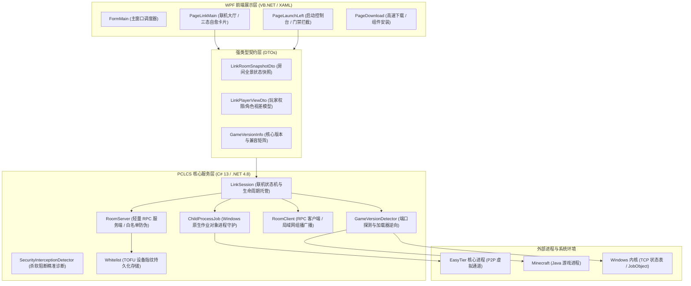

<p align="center">

<p align="center">
  <strong>PCL-TINGLIAO：一款高效、美观、高容灾的现代化 Minecraft 启动器</strong><br>
  <sub>全域深度加固版 · 去中心化 P2P 联机 2.0 · TOFU 设备指纹安全准入 · 游戏版本审核与智能自愈</sub>
</p>

<p align="center">
  
  
  
  
  
  
</p>

---

## 📖 项目简介 (Overview)

**Plain Craft Launcher 2 (PCL2)** 是一款广受 Minecraft 玩家喜爱的轻量级、模块化、高颜值启动器。本项目分支在官方坚实的代码基础上，实施了全方位的**架构高韧性重构（Robustness Hardening）**，彻底清退了历史遗留死代码与冗余配置，构筑了一套由现代化 C# 强类型内核驱动、覆盖局域网穿透联机、多维安全防护与智能故障自愈的工业级高可用启动生态。

---

## ✨ 核心特性与架构亮点 (Key Highlights)

### 1. 🚀 去中心化 P2P 局域网联机 (Campfire Link 2.0)
* **免驱动/免提权隧道**：依托 EasyTier 2.6.4 核心，采用纯应用层 TCP/UDP 隧道转发（`no_tun = true`），无需安装任何虚拟网卡驱动或向系统索取管理员 UAC 提权，双击即用。
* **自包含 16 位防伪邀请码**：采用 Base32 编码并内嵌 Reed-Solomon 校验算法（形如 `U/XXXX-XXXX-XXXX-XXXX`），邀请码自包含加密网络凭证与房主寻址线索，支持混杂聊天文本正则提取与防篡改验证。
* **局域网组播嗅探与无缝接入**：访客端自动在本地模拟标准 Minecraft 局域网广播（UDP 组播 `224.0.2.60:4445`），进入游戏【多人游戏】列表底部即可直接看到好友房间，零配置一键加入。

### 2. 🛡️ 原生进程树孤儿保护 (ChildProcessJob)
* **Windows JobObject 句柄守护**：底层利用操作系统内核级 `CreateJobObject` 与 `JobObjectExtendedLimitInformation`，将联机底层网络引擎进程绑定至主程序生命周期作业对象。
* **100% 连带终结**：无论 PCL2 遭遇系统蓝屏、用户任务管理器强制结束还是异常闪退，操作系统内核级保证子进程 100% 连带清理，杜绝后台 EasyTier 僵尸进程占用网卡、端口及 CPU。

### 3. 🔐 多维安全准入与 TOFU 动态设备绑定
* **微软正版 UUID 强一致性**：微软正版玩家无论如何更换电脑或修改游戏昵称，凭不可伪造的 32 位 UUID 享有最高优先级的无缝准入。
* **离线玩家 TOFU（首次信任）绑定**：离线好友首次连入时，系统自动捕获其硬件物理设备特征码（`MachineId`）并动态持久化绑定；后续若有同名不同设备冒充连入，服务端自动识别并拦截。
* **细分信令与房主平滑自愈**：针对好友更换电脑场景，服务端精准返回细分信令 `campfire:whitelist_device_mismatch`，并在房主前端界面开放“重置设备绑定”操作，点击即可一键重绑，消除误拦截。
* **管理员鉴权防伪令牌 (AdminToken)**：房主授权的房内管理员获发由密码学安全随机生成的 32 位 Token，服务端严格核验，杜绝管理员互踢与越权踢出房主漏洞。

### 4. 🩺 杀软阻断精准诊断与自愈引导 (SecurityInterceptionDetector)
* **精准拦截诊断**：启动网络引擎时深度拦截 Win32 原生异常，精准识别 Windows Defender / 360 / 火绒造成的特征码阻断：
  * `ERROR_VIRUS_INFECTED` (225)：文件包含病毒或潜在的垃圾软件（杀软隔离阻断）
  * `ERROR_ACCESS_DISABLED_BY_POLICY` (1260)：系统组策略限制阻止
  * `ERROR_ACCESS_DENIED` (5)：权限拒绝
* **白名单自愈引导**：一旦识别拦截，前端自动弹出“联机核心被安全软件拦截”专项诊断卡片，提供“一键复制组件路径”与防误报排查教程，降低玩家支持门槛。

### 5. 🧩 Minecraft 核心版本审核与智能三态自愈 (Version Verification & Self-Healing)
* **实时游戏探针 (`GameVersionDetector`)**：
  * **网络层 Legacy Ping**：房主对局域网开放后，自动向本地世界端口发送 0xFE 探测帧，实时获取服务端精确 Minecraft 核心版本与网络协议版本号。
  * **进程命令行深度逆向**：通过 Windows 句柄提取 Java 进程完整启动参数，正则识别 Mod 加载器（`Fabric`、`Forge`、`NeoForge`、`Quilt` 或 `Vanilla`）。
* **轻量级协议广播 (`c:game_version`)**：房主端自动将核心版本信息（格式如 `1.20.1|Fabric|763`）向房间广播。
* **小白访客端三态自愈界面 (`CardVersionCheck`)**：
  * 🟢 **状态 1：完全匹配** -> 绿色通过徽章，显示“启动游戏”，点击立即拉起客户端并加入房间。
  * 🔵 **状态 2：版本不一致，但本地存在兼容实例** -> 蓝色自愈徽章，提示“已在你的电脑中找到对应版本【实例名】”，提供【一键切换版本】按钮，点击立即切换实例。
  * 🟡 **状态 3：本地未安装对应版本** -> 黄色引导徽章，提示“未安装对应版本”，提供【一键下载版本】按钮，直达下载安装页面。
* **启动门禁守卫 (Gatekeeper Defense)**：若访客在主界面误点“启动游戏”，PCL2 会在前置拦截并弹出中文对话框，提供“自动切换并启动”或“前往下载”，彻底杜绝因版本不匹配导致的进服崩溃。

### 6. 🧹 零污染配置与全域死代码清退
* 经过数轮全代码域严格扫描，彻底移除了 26+ 项前端已删除但后台仍在读写的“幽灵设置键”以及无用的残留控制项（如 `LinkAutoOpenLan`、`LinkShareMods`、`LinkServeMods`、`VersionRamOptimize` 等），保证配置文件与注册表零冗余、零脏写。

---

## 🏛️ 系统架构 (Architecture)



---

## 📂 仓库目录结构 (Directory Tree)

```text
├── .github/                       # GitHub Actions CI 流水线与 issue 模板
│   └── workflows/build.yml        # 自动化编译产物工作流
├── MeloongCore/                   # 跨平台通用基础核心类库 (C#)
│   ├── Shared/                    # 文件系统、密码学、任务调度、异步辅助类
│   ├── Wpf/                       # WPF 动画、转换器与视图组件
│   └── Tests/                     # MeloongCore 单元测试
├── PCLCS/                         # PCL 现代化 C# 核心库 (C# 13 / .NET 4.8)
│   ├── Launch/                    # 启动命令行组装、JVM 参数调优、JavaWrapper
│   ├── Link/                      # 联机核心子系统
│   │   ├── Contracts/             # 强类型 UI 契约 (LinkRoomSnapshotDto 等)
│   │   ├── Minecraft/             # 端口探针、游戏版本探测、本地世界寻找
│   │   ├── Room/                  # RoomProtocol 协议帧、RoomServer、RoomClient
│   │   ├── Runtime/               # ChildProcessJob 进程树守护、EasyTier 运行时
│   │   ├── Whitelist.cs           # TOFU 设备特征码绑定与正版鉴权白名单
│   │   ├── Blocklist.cs           # 黑名单管理器
│   │   └── LinkSession.cs         # 联机核心会话状态机
│   └── Minecraft/                 # 版本清单拉取、McVersion 结构、安装元数据
├── Plain Craft Launcher 2/        # PCL2 主程序 (VB.NET / WPF)
│   ├── Controls/                  # 现代化扁平控件库 (MyButton, MyCard, MyHint 等)
│   ├── Modules/                   # 启动、下载、联机、皮肤、崩溃分析模块
│   └── Pages/                     # 功能子页面 (启动、下载、联机、设置、管理)
├── Tests/                         # 自动化综合回归测试套件
│   ├── TestLauncherAllFeatures.cs # 核心支柱自动化测试套件 (153 项测试)
│   └── TestAllAuxiliaryFeatures.cs# 辅助功能自动化测试套件 (64 项测试)
├── Plain Craft Launcher 2.sln    # 解决方案总文件
└── README.md                      # 本文档
```

---

## 🛠️ 编译与构建指南 (Build Guide)

### 环境要求 (Prerequisites)
* **操作系统**：Windows 10 / Windows 11 (x64)
* **开发工具**：Visual Studio 2022 (v17.0+) 带有以下工作负载：
  * `.NET 桌面开发` (包含 .NET Framework 4.8 开发工具包与 Windows SDK)
* **MSBuild 版本**：MSBuild 17.0+ / 18.0+

### 本地编译步骤 (Step-by-Step Build)

1. **克隆代码仓库**：
   ```bash
   git clone https://github.com/<your-username>/PCL2.git
   cd PCL2
   ```

2. **还原 NuGet 依赖**：
   ```powershell
   dotnet restore "PCLCS\PCLCS.csproj"
   ```

3. **使用 MSBuild 进行全量 Release 构建**：
   ```powershell
   & "MSBuild.exe" "Plain Craft Launcher 2.sln" /t:Rebuild /p:Configuration=Release /v:minimal
   ```
   *构建标准：本项目保持 **0 警告、0 错误** 标准编译通过。*

4. **可执行产物输出**：
   * 构建成功的独立主执行文件位于：`Plain Craft Launcher 2\bin\Plain Craft Launcher 2.exe`


## 📄 开源协议 (License)

本项目遵循 **GNU General Public License v3.0 (GPL-3.0)** 开源协议。
* 任何基于本项目源代码修改或分发的产品必须以相同协议开源。
* 严禁将本项目闭源包装或用于商业牟利。

---

<p align="center">
  Crafted with ❤️ for Minecraft Players & Developers
</p>
